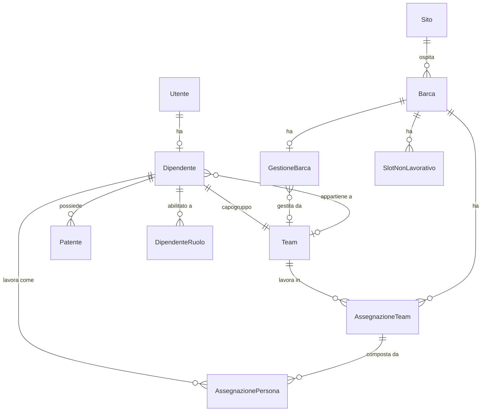

# Modello dei dati

Analisi del modello di dominio del Core (`src/PortPlanner`). Parte dalle [specifiche](../02-progettazione/specifiche-dettagliate.md) e dal [piano sul template](./template-e-adattamento.md). Le scelte numerate come "D1…" sono decisioni prese dal gruppo.

## Decisioni

| # | Decisione |
|---|---|
| D1 | Il login passa da una tabella `Utente` separata. Il Supervisore ha solo l'`Utente`; ogni lavoratore ha `Utente` e `Dipendente` collegati. |
| D2 | I ruoli Gruista, Muletista, Operaio sono un `enum` nel codice. |
| D3 | Il seed calcola le date a partire da oggi, così la demo è coerente in qualsiasi giorno. |
| D4 | Il seed contiene circa 25 lavoratori e 5 team. |
| D5 | Il contratto ha data di inizio e data di fine (vuota = indeterminato). |
| D6 | La barca ha anche tipo e quantità di merce. |
| D7 | Il Core ha un progetto di test xUnit, con un test sul seed. |

## Il database in memoria non fa rispettare i vincoli

`UseInMemoryDatabase` ignora indici univoci, chiavi esterne obbligatorie e vincoli di integrità. Quindi le regole del dominio ("un solo team per slot", "la stessa persona non può stare in due siti nello stesso slot") **vanno controllate nei servizi** (Command e validazione), non delegate a EF. Un test sul seed verifica che i dati di partenza le rispettino.

## Profili e accesso

- Profilo **Supervisore**: `Utente.IsSupervisore = true`, nessun `Dipendente`.
- Profilo **Capogruppo**: non è un campo. Un `Dipendente` è capogruppo se compare in `Team.CapogruppoId`.
- Profilo **Dipendente**: tutti gli altri lavoratori.
- Il profilo si calcola al login e finisce in un claim; il menu cambia di conseguenza.

## Entità

Gli identificatori sono `Guid`, come nel template.

### Accesso e anagrafica

**`Utente`**: `Id`, `Email` (univoca), `PasswordHash`, `IsSupervisore`.
La password è SHA-256 senza sale, come nel template: va bene solo per la demo.

**`Dipendente`**: `Id`, `UtenteId`, `Nome`, `Cognome`, `Telefono`, `TipoContratto` (`AContratto`, `AChiamata`), `OreSettimanali` (36 o 38; vuoto per i chiamati), `DataInizioContratto`, `DataFineContratto` (opzionale), `RuoloPrincipale`, `TeamId` (opzionale).
- Un solo team per lavoratore.
- Le ore settimanali sono obbligatorie per chi è a contratto.

**`DipendenteRuolo`**: `DipendenteId`, `Ruolo`. I ruoli abilitati oltre al principale. L'Operaio è implicito: non richiede patente e lo può fare chiunque.

**`Patente`**: `DipendenteId`, `Tipo` (`Gru`, `Muletto`), `Scadenza`. Nessuna riga = non posseduta. Lo stato valida/scaduta si calcola dalla scadenza.

**`Team`**: `Id`, `Nome`, `CapogruppoId` (un `Dipendente` del team). Un team ha sempre almeno un membro, il capogruppo.

### Siti e barche

**`Sito`**: `Id`, `Nome`, `Ordine`. Quattro siti fissi, una gru ciascuno.

**`Barca`**: `Id`, `Nome`, `SitoId`, `Arrivo` (data), `Partenza` (data), `TipoMerce`, `QuantitaMerce` (tonnellate, da confermare).
- Una barca sta su un solo sito.
- Blocchi veri, da controllare nel servizio: la partenza non precede l'arrivo; su un sito la partenza di una barca precede l'arrivo della successiva.

### Pianificazione

**`Slot`** (`enum`): `Dalle0Alle6`, `Dalle6Alle12`, `Dalle12Alle18`, `Dalle18Alle24`. Ogni slot vale 6 ore.

**`GestioneBarca`** (livello 3.0): `BarcaId` (uno a uno), `TeamGestoreId` (opzionale). Un team gestisce la barca per tutto il periodo e il capogruppo sceglie quando lavorare.

**`AssegnazioneTeam`** (livello 2.0): `Id`, `BarcaId`, `Data`, `Slot`, `TeamId`, `Origine` (`Supervisore` = imposto, `Capogruppo` = scelto nella gestione).
- Un solo team per barca, data e slot.
- L'assegnazione imposta dal supervisore prevale su quella del capogruppo e non si contesta.
- Lo stesso team può lavorare nello stesso slot su siti diversi, con persone diverse.

**`SlotNonLavorativo`**: `BarcaId`, `Data`, `Slot`, `TeamId`. Slot o giorno in cui il team non deve lavorare, deciso dal supervisore (3.0 per il team gestore, 2.0 dal menu dello slot).

**`AssegnazionePersona`** (livello 2.1): `Id`, `AssegnazioneTeamId`, `DipendenteId`, `Ruolo`, `NonSvolto` (il supervisore segna un turno passato come non lavorato).
- La stessa persona non può stare in due siti nello stesso slot: è un blocco vero, da controllare nel servizio.
- Un lavoratore fa un solo ruolo per slot.

### Rimandate alle loro schermate

`Richiesta`, `Assenza`, `DisponibilitaGiorno` e `PreferenzaSlot`, `Avviso` del capogruppo, `Notifica` del dipendente, storico del contratto. Non vanno scritte prima di avere le schermate: i loro campi dipendono dai dettagli dell'interfaccia.

## Relazioni in breve

## Seed

Date relative a oggi. Contenuto coerente con il prototipo:

- **Utenti:** il supervisore Mario Rossi e un utente per ogni lavoratore. Password di prova uguale per tutti (da scrivere nel README, solo demo).
- **Lavoratori:** circa 25, nomi inventati, con i personaggi del prototipo (Anna Conti, Luca Moro, Giorgio Neri, Sara Fontana, Paolo Riva, Luigi Marini a chiamata, Marco Bruno, Marta Pini senza team, Davide Longo). Mix di contratti, ruoli multipli e patenti (valide, scadute, mancanti).
- **Team:** cinque, ognuno con capogruppo (Anna Conti nel Team 2).
- **Siti e barche:** Sito 1–4. Barca A (Sito 1, oggi + 3 giorni), Barca B (Sito 2), Barca C (Sito 4, nei giorni successivi), Sito 3 libero. Il Team 2 gestisce la Barca A.
- **Assegnazioni:** alcune imposte dal supervisore, alcune scelte dal capogruppo, qualche slot non lavorativo, e almeno un caso utile alle anomalie (patente scaduta, riposo breve).

Il test sul seed verifica: un solo team per slot, nessuna persona in due siti nello stesso slot, ogni capogruppo è membro del suo team, barche senza sovrapposizioni sullo stesso sito.

## Cosa entra nella prima Pull Request

1. Le entità sopra, `Slot` e gli `enum`.
2. `PortPlannerDbContext` con le relazioni.
3. Il seed (`DataGenerator`) al posto di quello del template.
4. Il login agganciato a `Utente`, con il profilo nel claim.
5. Il progetto di test `PortPlanner.Tests` con il test sul seed.

Fuori dalla prima PR: Richiesta, Assenza, Avviso, Notifica, disponibilità e preferenze, servizio di validazione degli avvisi, schermate.

## Da confermare

- Unità e significato di `QuantitaMerce` (tonnellate?).
- Password del seed uguale per tutti.
