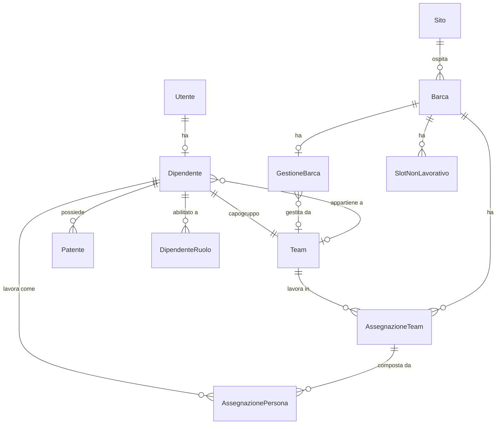

# Modello dei dati

Analisi del modello di dominio del Core (`src/PortPlanner`). Parte dalle [specifiche](../02-progettazione/specifiche-dettagliate.md) e dal [piano sul template](./template-e-adattamento.md). Le scelte numerate come "D1…" sono decisioni prese dal gruppo.

## Decisioni

| # | Decisione |
|---|---|
| D1 | Il login passa da una tabella `Utente` separata. Il Supervisore ha solo l'`Utente`; ogni lavoratore ha `Utente` e `Dipendente` collegati. |
| D2 | I ruoli Gruista, Muletista, Operaio sono un `enum` nel codice. |
| D3 | Il seed calcola le date a partire da oggi, così la demo è coerente in qualsiasi giorno. |
| D4 | Il seed contiene circa 25 lavoratori e 5 team. |
| D5 | Il contratto ha data di inizio e data di fine (vuota = indeterminato). |
| D6 | La barca ha anche tipo e quantità di merce. |
| D7 | Il Core ha un progetto di test xUnit, con un test sul seed. |
| D8 | `QuantitaMerce` è espressa in tonnellate. |
| D9 | Tutti gli utenti del seed hanno la stessa password di prova (demo). |
| D10 | `Utente` ha `Nome` e `Cognome`; `Dipendente` li legge dall'`Utente` collegato. Così anche il Supervisore ha un nome da mostrare. |
| D11 | Lo stato della patente ha tre valori calcolati: Valida, In scadenza (entro 30 giorni) e Scaduta. |
| D12 | Le date (`Arrivo`, `Partenza`, `Data`, scadenze, contratto) sono `DateOnly`. |
| D13 | Su un sito la partenza di una barca precede l'arrivo della successiva: mai lo stesso giorno. |
| D14 | `TipoMerce` è un `enum`. |
| D15 | Al login il cookie contiene i claim `Profilo`, `DipendenteId` e `TeamId` (se esiste). Se cambia il capogruppo serve un nuovo accesso. |
| D16 | Il seed ha cinque barche (D ed E arrivano dopo 7 giorni), nessuno storico, e la griglia del Team 2 su Barca A identica alle specifiche. |
| D17 | `DataGenerator.Initialize(context, oggi)` riceve la data: l'app passa quella di sistema, i test una fissa. Il seed parte da `Startup` all'avvio, non dal costruttore del `DbContext`, così i test dei modelli partono da un database vuoto. |
| D18 | `SlotNonLavorativo` appartiene alla barca, non a un team: la chiave è barca, data e slot. Cambiando il team gestore i blocchi restano; un'assegnazione del supervisore in uno slot bloccato vince e il blocco resta. |
| D19 | Il tempo di lavoro è continuo: gli slot contigui di una persona, anche a cavallo di mezzanotte, formano un **blocco**. Un blocco da 2 o più slot è l'avviso "turni consecutivi", con le ore reali (12, 18, 24 h). |
| D20 | Il riposo di 11 ore si misura **tra blocchi**: avviso se tra la fine di un blocco e l'inizio del successivo passano meno di 11 h. Dentro un blocco non c'è riposo da misurare. |
| D21 | Gli avvisi di riposo e di turni consecutivi hanno sempre gravità Normale; Forte è riservata a ferie, malattia e contratto scaduto. 18 e 24 h di fila restano un punto aperto. |
| D22 | La validazione guarda i turni della persona su ogni sito e ogni team (il vincolo è sulla persona) e ignora le `AssegnazionePersona` con `NonSvolto`. Il turno da valutare si aggiunge a quelli esistenti senza contarlo due volte. |

## Il database in memoria non fa rispettare i vincoli

`UseInMemoryDatabase` ignora indici univoci, chiavi esterne obbligatorie e vincoli di integrità. Quindi le regole del dominio ("un solo team per slot", "la stessa persona non può stare in due siti nello stesso slot") **vanno controllate nei servizi** (Command e validazione), non delegate a EF. Un test sul seed verifica che i dati di partenza le rispettino.

## Profili e accesso

- Profilo **Supervisore**: `Utente.IsSupervisore = true`, nessun `Dipendente`.
- Profilo **Capogruppo**: non è un campo. Un `Dipendente` è capogruppo se compare in `Team.CapogruppoId`.
- Profilo **Dipendente**: tutti gli altri lavoratori.
- Il profilo si calcola al login (`CheckLoginCredentialsQuery`, enum `Profilo`) e finisce nel cookie: `ClaimTypes.Role` contiene il profilo, più `ClaimTypes.Name` (nome e cognome), `PortPlanner.DipendenteId` e `PortPlanner.TeamId` (assenti per chi non li ha). Il menu cambia di conseguenza.
- Se cambia il capogruppo o il team di una persona, il suo cookie resta com'era finché non rientra (D15). Un cookie senza profilo, come quelli emessi prima di questa regola, porta a un nuovo login.
- Email e password errate, o un account che non è né supervisore né lavoratore, danno lo stesso messaggio ("Email o password errate"): non si capisce quali email esistono. L'email si confronta senza maiuscole né spazi.
- Le pagine del Supervisore e del Capogruppo stanno in due aree (`Areas/Supervisore`, `Areas/Capogruppo`). Il controller base di ogni area ha `[Authorize(Roles = ...)]` con le costanti `Profili.Supervisore`, `Profili.Capogruppo` e `Profili.Dipendente`. Ogni profilo apre solo la propria area: il supervisore non apre le pagine del capogruppo.
- Chi apre una pagina di un altro profilo arriva ad "Accesso negato" (risposta 403): "Questa pagina non è disponibile per il profilo ...", con il menu del proprio profilo e il pulsante "Torna alla home". Chi non è collegato va al login.
- Dopo il login si passa da `Dashboard/Index`, che manda Supervisore e Capogruppo alla loro home. Il Dipendente resta sulla pagina provvisoria finché non c'è l'app mobile.
- L'indirizzo di ritorno dopo il login (`returnUrl`) si segue solo se è interno all'app.
- Il Supervisore accede dalla stessa pagina di login degli altri, con email e password. Non esiste registrazione: gli account nascono dal seed. Il Supervisore non è un lavoratore: non ha turni, non è in nessun team e non può essere capogruppo.

## Entità

Gli identificatori sono `Guid`, come nel template.

### Accesso e anagrafica

**`Utente`**: `Id`, `Email` (univoca), `PasswordHash`, `Nome`, `Cognome`, `IsSupervisore`.
La password è SHA-256 senza sale, come nel template: va bene solo per la demo.

**`Dipendente`**: `Id`, `UtenteId` (nome, cognome ed email stanno sull'`Utente`), `Telefono`, `TipoContratto` (`AContratto`, `AChiamata`), `OreSettimanali` (36 o 38; vuoto per i chiamati), `DataInizioContratto`, `DataFineContratto` (opzionale), `RuoloPrincipale`, `TeamId` (opzionale).
- Un solo team per lavoratore.
- Le ore settimanali sono obbligatorie per chi è a contratto.

**`DipendenteRuolo`**: `DipendenteId`, `Ruolo`. I ruoli abilitati oltre al principale. L'Operaio è implicito: non richiede patente e lo può fare chiunque.

**`Patente`**: `DipendenteId`, `Tipo` (`Gru`, `Muletto`), `Scadenza`. Nessuna riga = non posseduta. Lo stato si calcola dalla scadenza (`StatoAl(oggi)`): **Scaduta** dal giorno dopo la scadenza, **In scadenza** negli ultimi 30 giorni (scadenza compresa), altrimenti **Valida** (D11).

**`Team`**: `Id`, `Nome`, `CapogruppoId` (un `Dipendente` del team). Un team ha sempre almeno un membro, il capogruppo.

### Siti e barche

**`Sito`**: `Id`, `Nome`, `Ordine`. Quattro siti fissi, una gru ciascuno.

**`Barca`**: `Id`, `Nome`, `SitoId`, `Arrivo` (`DateOnly`), `Partenza` (`DateOnly`), `TipoMerce` (`enum`: Container, RinfuseSolide, RinfuseLiquide, MerciVarie, Rotabili, ProdottiForestali), `QuantitaMerce` (in tonnellate, intero).
- Una barca sta su un solo sito.
- Blocchi veri, da controllare nel servizio: la partenza non precede l'arrivo; su un sito la partenza di una barca **precede** l'arrivo della successiva, mai lo stesso giorno (D13).

### Pianificazione

**`Slot`** (`enum`): `Dalle0Alle6`, `Dalle6Alle12`, `Dalle12Alle18`, `Dalle18Alle24`. Ogni slot vale 6 ore; `OraInizio()` e `OraFine()` danno gli estremi (0–6, 6–12, 12–18, 18–24).

**`GestioneBarca`** (livello 3.0): `BarcaId` (è la chiave: una gestione per barca), `TeamGestoreId` (opzionale). Un team gestisce la barca per tutto il periodo e il capogruppo sceglie quando lavorare.

**`AssegnazioneTeam`** (livello 2.0): `Id`, `BarcaId`, `Data`, `Slot`, `TeamId`, `Origine` (`Supervisore` = imposto, `Capogruppo` = scelto nella gestione).
- Un solo team per barca, data e slot. Nel `DbContext` c'è un indice univoco su questi tre campi, ma con il database in memoria non viene fatto rispettare: il controllo vero è nel servizio.
- L'assegnazione imposta dal supervisore prevale su quella del capogruppo e non si contesta.
- Lo stesso team può lavorare nello stesso slot su siti diversi, con persone diverse.

**`SlotNonLavorativo`**: `BarcaId`, `Data`, `Slot`. Slot di una barca in cui il team gestore non deve lavorare, deciso dal supervisore (3.0 per il team gestore, 2.0 dal menu dello slot). Non ha un `Id` né un team: la chiave è l'insieme di barca, data e slot (D18).
- Un giorno bloccato sono quattro righe, una per slot; "Ripristina giorno" le toglie.
- Il blocco appartiene alla barca: se cambia il team gestore, i blocchi restano.
- Il capogruppo gestore non può scegliere uno slot bloccato, ma pianifica liberamente gli altri.
- Il supervisore può comunque inserire un team (anche diverso dal gestore) in uno slot bloccato con una `AssegnazioneTeam` di origine `Supervisore`: l'assegnazione puntuale vince e la riga di blocco resta. Se l'inserimento viene tolto, lo slot torna bloccato.

**`AssegnazionePersona`** (livello 2.1): `Id`, `AssegnazioneTeamId`, `DipendenteId`, `Ruolo`, `NonSvolto` (il supervisore segna un turno passato come non lavorato).
- La stessa persona non può stare in due siti nello stesso slot: è un blocco vero, da controllare nel servizio.
- Un lavoratore fa un solo ruolo per slot.

### Rimandate alle loro schermate

`Richiesta`, `Assenza`, `DisponibilitaGiorno` e `PreferenzaSlot`, `Avviso` del capogruppo, `Notifica` del dipendente, storico del contratto. Non vanno scritte prima di avere le schermate: i loro campi dipendono dai dettagli dell'interfaccia.

## Relazioni in breve

## Seed

Date relative a oggi. Contenuto coerente con il prototipo:

- **Utenti:** il supervisore Mario Rossi e un utente per ogni lavoratore, con email `nome.cognome@portplanner.it`. Password di prova uguale per tutti, `Prova123` (solo demo, scritta nel README con un account per profilo).
- **Lavoratori:** 25 (24 in cinque team, più Marta Pini senza team), nomi inventati e telefoni finti (`+39 000 000 01NN`), con i personaggi del prototipo (Anna Conti, Luca Moro, Giorgio Neri, Sara Fontana, Paolo Riva, Luigi Marini a chiamata, Marco Bruno, Marta Pini senza team, Davide Longo). Mix di contratti, ruoli multipli e patenti (valide, scadute, mancanti).
- **Team:** cinque, ognuno con capogruppo (Anna Conti nel Team 2).
- **Siti e barche:** Sito 1–4. Barca A (Sito 1, oggi + 3 giorni), Barca B (Sito 2, oggi + 4), Barca C (Sito 4, da oggi + 3 a oggi + 6), Barca D ed E dopo 7 giorni, Sito 3 libero oggi. Il Team 2 gestisce la Barca A. Nessuno storico: il seed parte da oggi (D16).
- **Griglia di Barca A:** la griglia 4 giorni per 4 slot riproduce la tabella "Dati canonici" delle specifiche dettagliate: 7 assegnazioni (4 del supervisore, 3 scelte dal capogruppo del Team 2), 5 slot non lavorativi, gli altri da scegliere. Giorgio Neri lavora 12 ore di fila venerdì; Luigi Marini lavora mercoledì su A, venerdì su B e lunedì su C.
- **Anomalie di anagrafica:** una patente scaduta (Giorgio Neri, muletto), una in scadenza (Valentina Testa, gru), un contratto scaduto (Andrea Pellegrini), uno non ancora iniziato (Laura Basile), Luigi Marini a chiamata, Marta Pini senza team. La patente di Luigi Marini scade tra 45 giorni, così resta "valida" come nel prototipo.
- **Assegnazioni:** in tutto 24 slot assegnati con 77 persone, alcune imposte dal supervisore, alcune scelte dal capogruppo, 10 slot non lavorativi e quattro casi per le anomalie: ruolo senza patente (Carlo Fiore gruista senza patente, Giorgio Neri muletista con patente scaduta), riposo breve (Marco Bruno, 18–24 e poi 0–6), contratto scaduto assegnato (Andrea Pellegrini), persona senza team (Marta Pini) e persona di un altro team (Luca Moro nel Team 5).

Il test sul seed verifica: un solo team per slot, nessuna persona in due siti nello stesso slot, ogni capogruppo è membro del suo team, barche senza sovrapposizioni sullo stesso sito.

## Come si divide il lavoro in Pull Request

Cinque PR in sequenza: la successiva parte da `main` dopo il merge della precedente.

1. `feat/dominio-anagrafica`: `Utente`, `Dipendente`, `DipendenteRuolo`, `Patente`, `Team` e i loro `enum`, `PortPlannerDbContext`, progetto `PortPlanner.Tests`. Il vecchio `User` del template resta finché il login non passa a `Utente` (PR 5, ora fatta: `User`, le sue query e gli utenti `email1@test.it` sono stati tolti).
2. `feat/dominio-pianificazione`: `Sito`, `Barca`, `GestioneBarca`, `AssegnazioneTeam`, `SlotNonLavorativo`, `AssegnazionePersona`, `Slot`, `TipoMerce`, `OrigineAssegnazione`.
3. `feat/seed`: `DataGenerator` con circa 25 lavoratori, 5 team, 4 siti e 5 barche; password di prova nel README.
4. `test/seed`: i test sul seed (un solo team per slot, nessuna persona in due siti nello stesso slot, ogni capogruppo è membro del suo team, barche senza sovrapposizioni sullo stesso sito).
5. `feat/login-profilo`: login agganciato a `Utente`, profilo nel claim (D15), test di login.

Fuori da queste PR: Richiesta, Assenza, Avviso, Notifica, disponibilità e preferenze, servizio di validazione degli avvisi, schermate.
